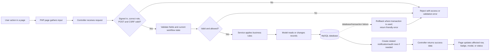
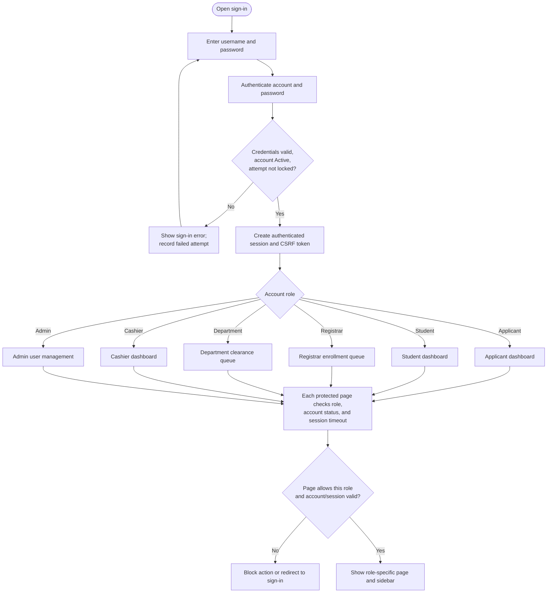
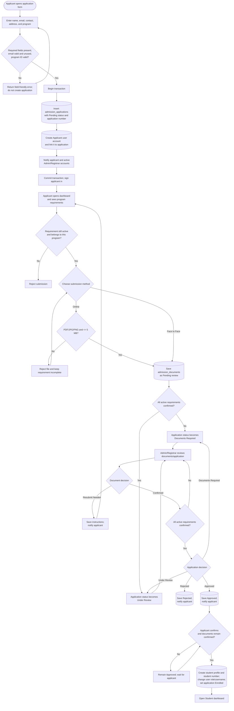
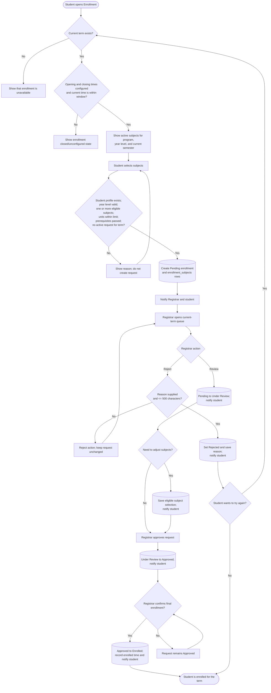
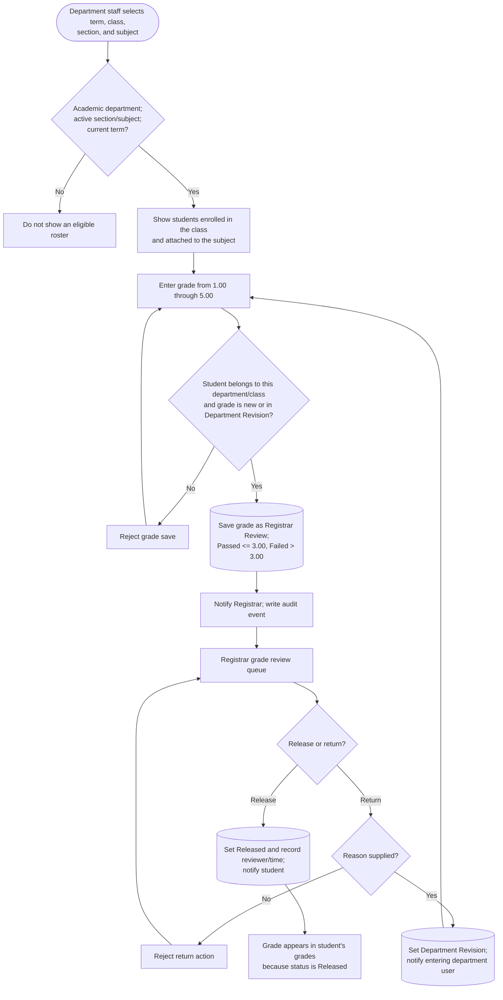
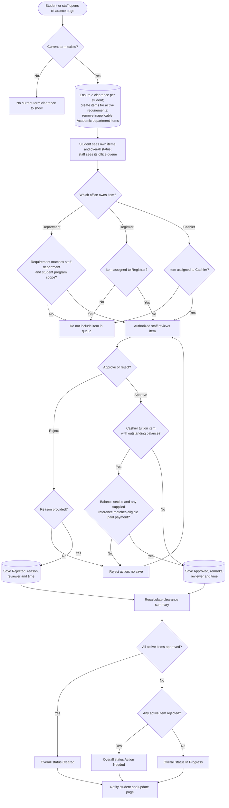
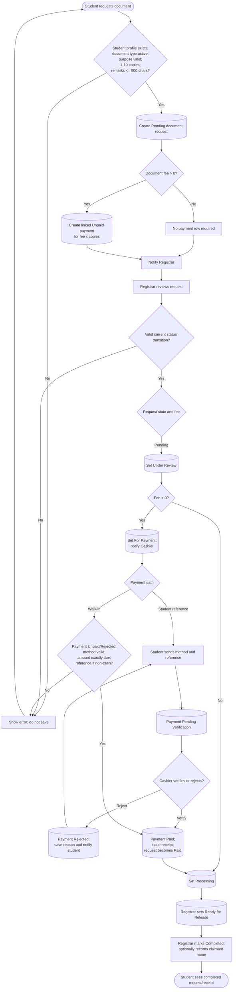
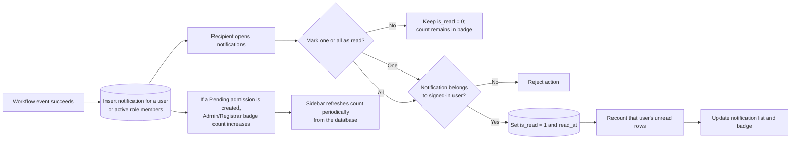
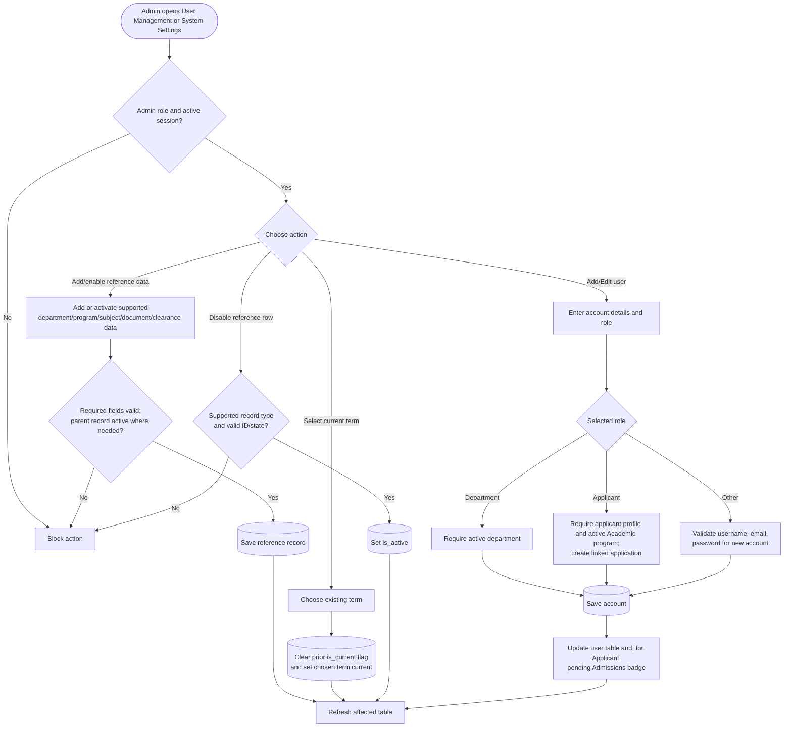

# SSIS System Flow

This file turns the main SSIS workflows into flowcharts. Each chart is designed to be copied into a diagram tool or used as a starting point for a more detailed design. The labels name the decision and the branch conditions; database writes are shown in square nodes.

## 1. How a request travels through the application

### What the boxes mean

- **Page:** the screen the user sees under `php/<role>/`, or the public `application.php` form.
- **Controller:** checks the request and sends it to the relevant workflow. Controllers live in `controller/`.
- **Service:** validates and coordinates workflow-specific work. Services live in `services/`.
- **Model:** reads and writes application records. Models live in `models/`.
- **Database:** stores the authoritative state. The next action is decided from the saved state, not from the appearance of a button.
- **UI update:** a successful response updates the relevant parts of the current screen. If validation fails, the operation should not be presented as successful.

## 2. Sign-in and role routing

## 3. Admission: public form to Student account

**Records involved:** `admission_applications`, `users`, `admission_document_requirements`, `admission_documents`, `students`, `number_sequences`, `notifications`.

## 4. Enrollment request and Registrar decision

**Conditions to keep beside the chart:** a rejected/cancelled prior request does not block a new request; other existing request statuses do. Only the student who owns a `Pending` request can cancel it. Prerequisites count only when a grade is both `Released` and `Passed`.

**Records involved:** `terms`, `students`, `subjects`, `subject_prerequisites`, `grades`, `enrollments`, `enrollment_subjects`, `notifications`, `audit_logs`.

## 5. Grade submission, review, and release

**Records involved:** `enrollments`, `enrollment_subjects`, `sections`, `subjects`, `grades`, `grade_revisions`, `notifications`, `audit_logs`.

## 6. Clearance creation, office review, and summary

Clearance rows/items are generated for the current term when the Student clearance page ensures term clearances. The Student page displays the items and overall status; the approval/rejection actions belong to the office assigned to each requirement.

**Records involved:** `terms`, `students`, `programs`, `clearances`, `clearance_requirements`, `clearance_items`, `document_requests`, `payments`, `notifications`, `audit_logs`.

## 7. Document request and payment transaction

Registrar status transitions are also state-checked: `Pending` to `Under Review`; `Under Review` to `For Payment` if fee-bearing or `Processing` if free; `Paid` to `Processing`; `Processing` to `Ready for Release`; and `Ready for Release` to `Completed`. Rejection is a separate action requiring a reason. Refunds are allowed only for Paid payments attached to requests that are Cancelled or Rejected, and require a reason.

**Records involved:** `document_types`, `students`, `document_requests`, `payments`, `number_sequences`, `notifications`, `audit_logs`.

## 8. Notifications and badges

## 9. Admin configuration and account management

## 10. Failure and retry paths to show in diagrams

When drawing a workflow, include these branches wherever a save can happen:

1. **Access failure:** wrong role, expired session, inactive account, wrong method, or invalid CSRF token. Stop before the write.
2. **Business-rule failure:** invalid fields, wrong ownership, inactive reference data, or a disallowed status transition. Return an error and keep the record unchanged.
3. **Stale state:** the row has changed since the page loaded. Re-read/lock the current row and reject a transition that no longer matches its expected status.
4. **Database failure:** roll back any open transaction; do not show a success state.
5. **Success:** commit changes, write any related notification/audit data, return the saved identifiers/status, and update the associated UI.

## 11. Code landmarks for diagram validation

| Flow | Page | Controller/service/model |
| --- | --- | --- |
| Application and admissions | `application.php`, `php/applicant/dashboard.php`, `php/registrar/admissions.php` | `controller/admissionController.php`, `services/AdmissionService.php`, `models/Admission.php` |
| Enrollment | `php/student/enrollment.php`, `php/registrar/enrollment.php` | `controller/enrollmentController.php`, `services/EnrollmentService.php`, `models/Enrollment.php` |
| Grades | `php/department/grades.php`, `php/registrar/grades.php`, `php/student/grades.php` | `controller/gradeWorkflowController.php`, `services/GradesService.php`, `models/Grades.php` |
| Clearance | `php/student/clearance.php`, `php/department/clearance.php`, `php/cashier/clearance.php`, `php/registrar/clearance.php` | `controller/clearanceController.php`, `services/ClearanceService.php`, `models/Clearance.php` |
| Document requests and payments | `php/student/requests.php`, `php/registrar/documentRequest.php`, `php/cashier/payments.php` | `controller/documentRequestController.php`, `controller/paymentsController.php`, related services and models |
| User and settings administration | `php/admin/userManagement.php`, `php/admin/systemSettings.php` | `controller/adminUserController.php`, `controller/adminSettingsController.php` |

For the full field rules and display conditions, see [conditions.md](conditions.md). For each role's broader journey, see [user-flow.md](user-flow.md).
